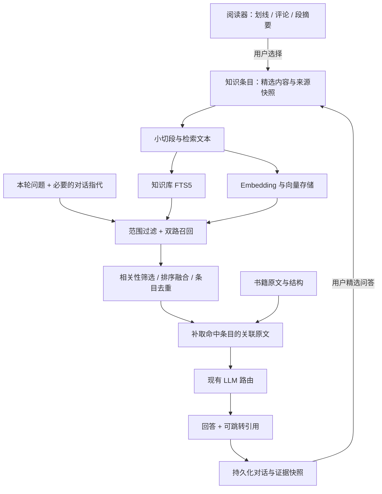

# 阅读知识库 v1 技术方案

日期：2026-10-29。状态：已搁置，当前实施范围见 [问书库 v1](ask-library-v1.md)。本方案尚未实施；下文参数与性能指标均为待验证的初始配置或验收目标。

## 1. 产品约束与技术结论

目标：围绕用户精选的评论、划线和段摘要，准确召回阅读积累，借助 LLM 产生有价值、可追溯、可继续阅读的交互。

- 一个用户一个阅读知识库；第一版不建设多个库、文件夹、知识图谱或自动整理系统。
- 原有笔记、划线查询界面继续负责记录管理。知识库提供语义召回、简单问答和历史对话。
- 沿用讨论中确认的精选机制：划线、评论、段摘要经用户选择后入库；不自动导入全部历史笔记。
- 入库后的评论、划线优先于精选摘要，但相关性是前提。
- 不提供整书入库，也不提供隐含的全文入库接口。批量选择仍然逐条创建知识条目。
- 书籍全文作为可按出处读取的上下文，不成为知识库的默认检索候选。
- 所有对话持久化。用户选择的回答或问答可以另存为知识，聊天不会自动形成新一轮检索材料。

推荐实现：**现有 Python sidecar + SQLite + 独立 FTS5 索引 + sqlite-vec + Ollama 上的 Qwen3-Embedding-0.6B + 现有对话模型路由**。

## 2. 当前代码基础与必须处理的差异

| 当前实现 | 复用方式或差异 |
| --- | --- |
| `apps/macos` 原生 SwiftUI；`packages/lumina-core` 为 FastAPI sidecar | 知识入库、索引和问答均在 core；原生客户端只处理交互、展示与导航 |
| `db/schema.py` 中已有 `books / segments / notes` | 继续作为阅读资料和阅读记录的数据来源 |
| 书籍已有 `category`；段落已有 `heading_path / chapter / page_range` | 纳入检索过滤、证据组装和引用展示。当前未发现独立书籍标签表，不假设完整标签体系已经存在 |
| `search/fts.py` 混合索引书名、段摘要、部分原文、笔记 | 新建知识库专用索引，不能直接调用现有跨书搜索，否则未精选内容会混进来 |
| `chunker/embeddings.py` 已有 Ollama / ONNX 调用 | 可提取请求、取消与批处理代码；其边界评分器不能直接充当检索 embedding 服务 |
| `chat/service.py` 已有模型路由、上下文预算、SSE | 复用基础能力，新增知识问答服务；不复用会自动取全书摘要和书内全文命中的上下文组装 |
| `chat_sessions` 强绑定单本书；`ChatRepo` 每书取一个会话 | 新的通用阅读对话存储支持跨书、多会话，并迁移已有聊天 |
| `SegmentRepo.commit_staging_replace / replace_for_book` 会删除笔记与书内聊天 | 必须先改变这条数据生命周期；知识条目、对话及阅读记录不能因重新分段消失 |
| 已有后台任务和任务状态注册 | 增加知识索引任务，沿用状态展示；独立低优先级执行，不阻塞阅读与健康检查 |

只新增本方案文档，不修改现有产品代码或已有 PRD/TDD。

## 3. 数据与检索分层



**知识条目、检索切段、原文上下文、聊天记录分别存储。** 长评论拆成多个切段后仍是一条评论；补取的原文不会因此入库；历史回答不会自动作为知识再次被召回。

## 4. 核心数据模型

继续使用本机现有 SQLite，由 core 统一写入。新增普通表如下，字段为设计级定义，实施时补充约束、索引与迁移。

| 表 | 核心字段与用途 |
| --- | --- |
| `knowledge_items` | `id, kind, source_key, source_ref_json, body, quote, provenance_json, source_snapshot_json, source_anchor_json, revision, state, created_at, updated_at`；产品中的知识条目及其独立保存的精选内容 |
| `knowledge_chunks` | `id, item_id, item_revision, chunk_index, body, retrieval_text, text_hash, fts_rowid`；可重建的小切段，FTS 与向量命中统一映射到这里 |
| `embedding_profiles` | `id, provider, model, model_digest, dimensions, normalization, query_template_version, document_template_version, state`；固定向量空间与处理配置，标明当前生效配置 |
| `knowledge_embeddings` | `chunk_id, profile_id, text_hash, vector BLOB, created_at`；唯一约束 `(chunk_id, profile_id)`，float32 向量，与对应文本版本绑定 |
| `reading_conversations` | `id, title, origin, scope_json, created_at, updated_at`；支持知识库会话与既有书内会话，书籍关联是可选范围而非级联删除条件 |
| `reading_messages` | `id, conversation_id, turn_id, seq, role, content, citations_json, status, request_id, scope_snapshot_json, model_json, created_at, updated_at`；保存有序问答、引用位置映射、流式草稿与失败状态 |
| `reading_evidence` | `id, message_id, evidence_key, item_id, item_revision, source_anchor_json, metadata_snapshot_json, selected_text, original_excerpt`；本轮使用的证据及引用快照，条目删除不级联清理历史证据 |

另建 `knowledge_fts` 虚拟表；复用现有 `jobs` 保存待处理任务，不引入新的任务服务。

### 4.1 来源类型和身份

`kind` 为 `highlight / comment / summary / dialogue_excerpt`。前三项为第一版主要输入；对话精选使用同一底层入库能力。

- `source_key` 是稳定幂等键，避免用户重复点击生成多份条目。笔记使用 note ID；段摘要使用来源锚点与用户选取的摘要单元；问答使用消息 ID 集合。
- `source_ref_json` 记录现有 note、segment 或 conversation/message 的引用，允许来源失效。
- `source_snapshot_json` 保存入库时的精选正文、关联引文及书名等信息，不能只存一个外键。
- `provenance_json` 区分作者原文、用户评论、AI 摘要、用户精选的 AI 回答；AI 内容记录生成模型与来源。
- `state` 区分有效、已移除等产品状态；embedding 的 pending/ready/error 由任务与向量覆盖情况表达。
- 笔记或摘要来源的删除、重建不级联删除知识条目。用户在知识库中主动移除，才停止该条目的召回。

### 4.2 书籍分类、标签与快照

当前书籍的标题、分类、标签用于当前筛选；证据快照用于重放旧对话，二者不能互相覆盖。

第一版复用 `books.category`。若现有元数据中有标签则一并读取；没有时为空，不为知识库生成另一套分类。标签存取若需补齐，可使用统一的书籍元数据字段，由阅读资料层维护。

书名和章节标题进入检索文本；分类、标签首先作为结构化过滤条件。修改后更新相关条目的检索投影；历史回答仍展示当时的快照。书籍已移除时，条目回退到最后保存的来源元数据，保持可检索，并标记来源不可用。

### 4.3 来源位置不能依赖段号

当前分段 ID 会重建，段号也会变化。新增共享 `SourceAnchor`：

```json
{
  "book_id": "book-id",
  "document_revision": "canonical-text-hash",
  "start_codepoint": 10240,
  "end_codepoint": 10420,
  "exact_quote": "被选中的原文",
  "prefix": "前面的短上下文",
  "suffix": "后面的短上下文",
  "heading_path": ["第二章", "第一节"],
  "page_range": "18–19",
  "segment_id_hint": "current-segment-id"
}
```

- 每个文档版本保存规范化原文快照文件，以及阅读段到该文本的范围映射；这只是出处文件，不参与全文 embedding。
- 新导入在分段前落地规范化文本；大 TXT 边处理边写，不为知识库额外把全书加载进内存。
- 旧书先用当前已保存的段原文顺序建立文本快照和映射，避免重新抽取导致旧笔记位置静默偏移。
- 偏移统一为 Unicode codepoint 的 `[start, end)`；客户端 UTF-16 位置需明确转换，不得使用展示字数 `count_units` 代替偏移。
- 重分段若原文版本不变，按范围重新映射；若重新抽取后的文本哈希变化，则创建新版本，再用原句、前后文、结构位置匹配。
- 重复引文不能只取第一个命中；无法唯一定位时保留快照并标为“原文位置待确认”，不跳到猜测的位置。
- 用户选择整个段摘要时，锚点指向被摘要的原文范围；不能把摘要文字冒充书中的原句。
- 既有笔记也接入锚点解析。其 `segment_id NOT NULL` 约束需迁移为可空并调整关联查询，才能保留暂时无法重新定位的笔记。

## 5. 入库、切段与更新

### 5.1 入库流程

1. 客户端提交来源类型、来源 ID、选取范围或摘要单元，携带幂等键。
2. core 读取真实来源，生成内容与原文锚点快照；不接受客户端伪造的书籍归属。
3. 在短事务中写入条目、轻量切段、FTS 与索引任务，返回 `item_id + indexing_status`。
4. 后台小批量调用 embedding；网络、模型推理期间不持有数据库写锁。
5. 提交前校验条目仍有效、revision 与 text_hash 未变，丢弃过期任务结果。
6. 模型不可用时保留已保存内容与关键词搜索，显示语义索引待完成，允许重试。

批量选中段落只是批量执行同一流程。选择“摘要”只索引所选摘要；选择“原文段落”只索引所选原文，不能由摘要操作悄悄纳入全文。

### 5.2 切段策略

| 输入 | 策略 |
| --- | --- |
| 短划线 | 完整保留，一条通常一个切段 |
| 评论 | 评论为主，配关联划线；必要时附短原文背景，避免“这里很重要”等评论失去语义 |
| 精选摘要 | 只提取用户选择的总结句或要点正文；不直接索引整份 JSON、追问建议等辅助字段 |
| 超长内容 | 先按自然段，再按句子切分；初始目标约 300 token，软上限约 500，必要时保留约 40 token 重叠 |
| 精选问答 | 保存选中的问题与回答，并继承原证据关联；标明它是对话产物 |

这些数值是实验起点，不沿用现有阅读段约数千字的预算。知识检索切段独立于阅读分段，不调用 LLM 再次“概括”用户评论。

检索文本按来源标记组装，例如：

```text
书名：《示例书》
章节：第二章 / 决策
来源：用户评论
评论：这里和我上次项目的教训一样……
关联划线：当决策成本……
```

正文、评论、引文分字段保存；以上拼接文本只用于检索，不能丢掉身份信息。

### 5.3 更新与移除

- 用户修改已入库评论：条目 revision 增长，重建该条目的切段和 FTS，后台重算相关向量；旧版本不得混入当前召回。
- AI 重新生成段摘要：已精选摘要保持用户选择时的版本；可提示来源已更新，由用户明确刷新，避免精选内容自动漂移。
- 移除知识：事务内令条目失效并清理检索投影；读取端始终检查有效状态。旧对话证据继续保存。
- 删除原笔记或书籍：保留已精选条目及对话快照，来源显示不可用；不静默重新加入或批量删除知识。
- 并发生成中的回答使用开始时固定的证据快照；移除动作会阻止后续请求使用该条目，不会伪装成已撤回模型看到的内容。

## 6. 开源组件与部署

### 6.1 向量存储：SQLite + sqlite-vec

延续现有本地架构。sqlite-vec 是 C 实现的 SQLite 向量扩展，支持在普通表上计算向量距离，也提供 `vec0`。第一版建议直接对 `knowledge_embeddings` 的 BLOB 使用 cosine distance，先做结构化过滤再精确排序，便于管理版本、来源过滤和模型切换；数据量上升后再根据实测考虑 `vec0`。[官方 KNN 文档](https://alexgarcia.xyz/sqlite-vec/features/knn.html)

建议以 1 万切段为基础规模，5 万切段做压力测试。1024 维 float32 向量每 1 万条的原始向量约 39 MiB，尚未计入正文、FTS、SQLite 开销和迁移时的双份向量。精简内容仍然重要。

发布前必须验证打包后的 Python 是否能加载扩展；macOS 的部分 Python 构建缺少相关能力。sqlite-vec 仍是 pre-v1，固定测试通过的版本及二进制，不随环境漂移。[Python 集成说明](https://alexgarcia.xyz/sqlite-vec/python.html)、[项目说明](https://github.com/asg017/sqlite-vec)

使用普通向量表使降级简单：扩展不可加载时，由后台 NumPy 分块做同一向量空间的精确计算；将 NumPy 显式纳入相应发布依赖。若运行环境连该能力也不可用，降级为关键词检索并明确状态。不能把“无向量结果”冒充完整语义搜索。

### 6.2 Embedding：先采用 Qwen3-Embedding-0.6B

首选复用 Ollama 部署 `qwen3-embedding:0.6b`，通过 `/api/embed` 批量请求。该模型官方提供多语言能力，原生最大输出 1024 维，模型许可为 Apache 2.0；Ollama 当前该标签展示下载体积约 639 MB，这不是运行内存承诺。[模型卡](https://huggingface.co/Qwen/Qwen3-Embedding-0.6B)、[Ollama 模型页](https://ollama.com/library/qwen3-embedding:0.6b)

- 第一轮验证先使用完整 1024 维，并核对实际响应长度；后续再比较降维对本项目召回质量的影响。
- query 端按官方方式添加检索任务指令，document 端使用固定检索文本模板；归一化与模板版本全部进入 profile。
- `/api/embed` 设置 `truncate=false`，超限时显式报错并重新切段，避免静默丢文本；小批量大小先从 8–16 开始测试。[Ollama API](https://docs.ollama.com/api/embed)
- 固定模型 digest，而不只保存可变标签。不能像分段评分器一样自动选择任意已安装模型并混用已有向量。
- 更换模型、维度或模板时创建新 profile、后台重建；重建期间查询使用旧 profile，增量修改同时补齐两个 profile。切换前校验所有有效条目的当前版本覆盖率，完成后原子切换，不能混合比较不同空间的距离。
- 复用现有 Ollama 设置流程按需准备模型，不将 Torch / Transformers 和大权重打进 sidecar。
- 现有 ONNX scorer 的截断、池化逻辑是边界评分用途；只有在与目标模型官方处理一致且通过质量验证后，才能作为新的 embedding provider。

对话模型继续由现有 `ProfileModelRouter` 的 chat 配置承担。使用远程对话资源时，按既有资源选择发送本轮必要证据和历史；界面应明确所用资源。第一版知识问答不自动联网补充资料。

## 7. 召回与问答链路

### 7.1 召回

1. **确定范围**：用户明确选择的书籍、分类、标签为硬过滤。对话中推断的“那本书”仅在指代明确时沿用；歧义时展示候选，不自动扩大为全部。
2. **形成查询**：首轮直接检索；后续结合最近问题与已引用条目处理指代。只有“这个观点”等不能独立理解的追问，才做一次受约束的查询改写，保留原问题共同检索。
3. **双路召回**：对同一有效条目集合执行 embedding cosine 检索与独立 FTS5 检索，初始各取 20 个候选；针对“我的想法”限制或优先 comment。
4. **相关性筛选**：在真实数据上校准向量证据阈值，结合词面命中；排名高不等于相关。RRF 本身不能作为“资料充分”的判断。
5. **融合与优先级**：用 RRF 合并排名，例如 `Σ 1/(60 + rank)`；相关性接近时评论、划线优先于摘要，不使用未经校准的 BM25 与 cosine 直接相加。
6. **条目去重**：同一条目多个切段合并，重叠原文、同源摘要折叠展示；通常选 4–6 条有效知识，少则用少，不为了凑数塞入无关内容。
7. **原文补充**：只读取命中条目锚点附近的原文；第一版限制在所关联原文范围，不沿着全文再次扩散搜索。

FTS5 先复用 trigram 的部署基础，但单独生成安全的 MATCH 查询，不能把整句自然语言作为必须连续命中的短语。中文两字术语不能只依赖 trigram：官方说明短于三个 Unicode 字符的全文查询不会命中。第一版以向量为语义主路，并对短术语在已过滤的精选内容中做参数化、转义后的字面匹配补充，不扫描书籍全文。[FTS5 文档](https://www.sqlite.org/fts5.html#the_trigram_tokenizer)

### 7.2 上下文组装与回答

采用固定 RAG 流程；一个助手，无需规划器或多智能体。按条目组装带身份与出处的证据：

```text
[K1] 用户评论
书籍：《示例书》｜分类：经济｜章节：第二章｜原文位置：……
用户评论：……
关联划线：……
补充原文：……
```

- 总预算根据当前 chat 资源上下文窗口设定，给系统提示、当前问题和输出预留空间，剩余分给证据与历史。原文补充受限，不能挤掉评论本身。
- 持久化全部历史，但每轮只携带必要的最近轮次、当前范围和指代所需证据。超出窗口不等于删除历史。
- 模型输出沿用现有结构化回答方式，引用只使用本轮证据白名单的 `K1 / K2`；后端映射到真实位置并校验，不让模型编造 book ID、段号或引用文本。
- 区分“你曾评论”“书中原文”“精选摘要认为”“据此推测”。书籍资料作为证据，不能覆盖系统指令。
- 无相关积累时明确提示未找到；可以围绕问题澄清或继续讨论，但不能把模型常识写成用户积累中的事实。
- 结构化引用校验只保证引用存在；结论是否被证据支持仍需评测，不能仅靠 JSON 校验宣布回答可信。
- 第一版不增加单独 reranker。若评测表明“召回到了但前几条排序不对”，再考虑引入重排模型。

## 8. 对话持久化与再阅读

所有新知识库会话和书内会话使用统一 `reading_*` 存储；现有书内深聊的上下文模式可以保留，但不混入知识库召回范围。

1. 请求带唯一 `request_id`，先事务保存 user 消息与 pending assistant，分配递增 `seq`，再开始检索与模型调用。
2. 固定本轮范围和证据，将快照写入 `reading_evidence`，建立证据编号映射。
3. 流式输出期间按小时间窗口或增量阈值保存草稿，不逐 token 写 SQLite。结构化生成时只向界面发送 answer 字段的文本增量，JSON 缓冲和引用解析由 core 处理。
4. 完成后保存最终正文、引用和模型信息，再发完成事件；取消或失败保留部分文本与状态，取消处理和断连清理也要落库。崩溃恢复将遗留 generating 状态标为 interrupted，最末一小段尚未检查点保存的输出可能丢失。
5. 同一会话第一版串行生成；重复请求返回已有 turn。重试生成新的 turn 并关联原请求，不覆盖用户读过的失败回答。
6. 保存后的对话可以重新打开、继续提问；知识条目删除、书籍移除或重新分段不会删除历史正文与证据快照。
7. 选择回答或问答“保存为知识”时创建 `dialogue_excerpt`，保留对话来源与原始证据；不自动索引整段聊天。

已有 `chat_sessions / chat_messages` 做一次幂等迁移，保留原 ID 映射和消息顺序；旧引用缺少的原文快照尽力补齐，无法补齐则如实标记。切换读写到新表后，旧表短期只读留作迁移回退，不双写成两份真源。

## 9. 最小 API 与客户端接入

| 接口 | 用途 |
| --- | --- |
| `POST /knowledge/items` | 单条或显式选择列表入库，来源限笔记、段摘要、所选原文或精选问答；返回幂等结果和索引状态 |
| `GET /knowledge/items` | 分页读取精选条目，可按书籍/类型筛选；仅为必要管理，不复制笔记搜索界面 |
| `DELETE /knowledge/items/{id}` | 移除知识，不删除原划线、评论或历史聊天 |
| `POST /knowledge/search` | 自然语言检索，返回条目、来源、匹配摘录和完整的当前出处信息 |
| `GET /knowledge/status` | 有效条目数、待处理/失败数量、当前检索能力；不向普通用户暴露切段参数 |
| `POST /reading/conversations` | 创建会话，保存 origin 与范围 |
| `GET /reading/conversations` | 分页历史会话列表 |
| `GET /reading/conversations/{id}/messages` | 按 seq 分页恢复聊天及引用 |
| `POST /reading/conversations/{id}/turns` | 持久化提问并通过 SSE 返回回答 |
| `POST /reading/conversations/{id}/turns/{turn_id}/cancel` | 显式取消生成并保留已有草稿 |
| `GET /reading/evidence/{id}/resolve` | 返回可用原文位置，或来源不可用/位置待确认及快照 |

SSE 最小事件为 `accepted / status / token / done / error`，每个事件带 turn/message 标识。历史恢复以数据库为准，不依赖 SSE 缓存。

macOS 增加轻量 Knowledge 页面：历史会话、新对话、范围选择、问题输入、回答及引用；语义搜索和问答共用召回服务。阅读器和现有 Notes 页面增加“加入/移出知识库”状态。不另做一套划线评论搜索。后端合同保持跨平台，Windows 客户端按项目现有发布计划接入。

## 10. 模块边界与任务执行

建议新增：

```text
lumina_core/
  knowledge/
    service.py       # 入库、移除与版本一致性
    repository.py    # knowledge_* 数据访问
    chunking.py      # 精选内容的小切段
    embedding.py     # 固定 profile 的 Ollama provider
    retrieval.py     # 范围过滤、双路召回、融合和去重
    context.py       # 证据组装与预算
  sources/
    anchors.py       # 共享原文锚点及重新定位
  chat/
    knowledge.py     # 知识问答编排
    conversations.py # 通用阅读对话存储与流式生命周期
```

数据库迁移仍放 `db/schema.py`；API 在现有路由结构中增加独立 knowledge/reading routes；客户端沿用 `CoreClient`。

新增持久化任务类型 `knowledge_index / knowledge_rebuild`。首次启动只恢复任务状态，不在 lifespan 中完成全量索引；embedding 小批量、低优先级运行，查询优先。与摘要共用现有模型并发控制，避免 Ollama 模型来回加载或争抢资源。独立 DB 连接仍需遵循现有锁与短事务纪律。

## 11. 实施顺序与验收

| 阶段 | 交付 | 退出条件 |
| --- | --- | --- |
| P0 数据保全与打包验证 | 原文锚点、重分段保留笔记、通用对话迁移、sqlite-vec 和 embedding 打包 spike | 旧库升级可恢复；重分段不丢笔记/对话；打包应用可加载扩展或明确走已验证降级 |
| P1 精选入库 | 三种主要来源入库、幂等、切段、FTS、embedding、状态与移除 | 重复加入不重复；来源身份和出处完整；过期任务不会复活已移除条目 |
| P2 准确召回 | 范围过滤、混合检索、来源优先级、原文补取 | 标注查询集验证召回；未精选全文不进入候选；短术语与评论指代均有覆盖 |
| P3 对话闭环 | 原生会话入口、持久化流式问答、引用跳转、历史恢复、精选问答入库 | 完成、失败、取消、崩溃恢复均保存；用户能继续阅读旧对话并核对依据 |

建议建立 60–100 条人工标注的查询，覆盖评论意图、划线同义表达、精选摘要、中文两字术语、跨书比较、限定分类、否定表述、追问指代和无答案问题。对每题标注可接受条目、必要证据和不应命中的内容。

第一版质量门槛建议：

- 可回答查询的 Hit@5 ≥ 90%：前五个条目中至少出现一个标注相关条目；跨书比较题另验所需证据是否齐全。
- 关键原文事实均可回溯；在有原文版本与唯一锚点的用例中，定位不得跳错。无法定位可显式降级为快照。
- 无答案问题至少 90% 不将无关内容包装成知识库证据；人工检查回答是否混淆原文、用户观点和模型推断。
- 必测重分段、删除来源、摘要重生、条目修改、模型换代、重复请求、失败重试、取消和进程中断。
- 在声明的基准设备与 1 万切段数据上，检索数据库部分 P95 目标 ≤ 500ms；包含已加载模型的 query embedding 与召回目标 ≤ 2s。模型冷加载、生成时间单独记录，不能掩盖进检索均值。
- 上述指标为拟定发布门槛，并非本次已测结果。方案阶段不运行产品测试；实施后再报告测量设备、语料、结果与未达标项。

第一版范围止于精选入库、准确召回、带出处问答、对话保存与继续阅读。全书 embedding、多知识库、自动提炼聊天、知识图谱与复杂智能体编排均不进入首版。
